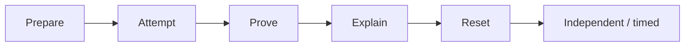

# CKS practice

Learn Kubernetes security by building controls, testing their boundaries, and explaining the results. **37 focused drills, one capstone, and reusable practice fixtures** connect the published CKS objectives to everyday security engineering.

Designed for learners who already administer Kubernetes at CKA level. Each exercise has a starting state, an observable outcome, positive and negative checks, and scoped cleanup.

## Start here

Start locally with Docker, kind, kubectl and Python 3.11+. The [environment guide](preparation/ENVIRONMENTS.md#kind-with-calico) lists the pinned tool versions and prerequisites:

```bash
python3 scripts/environment.py create --name cks-practice
```

Run the kubeconfig and context exports printed by setup. It prepares the cluster, networking and healthy witnesses while leaving the exercises for you to solve.

1. Follow the [first session](preparation/LAB-SAFETY.md#first-session): CS01 networking, CH02 ServiceAccounts and MW02 workload hardening.
2. Use the [concept maps](preparation/CONCEPTS.md) to connect each task to its security boundary. Explain why your allowed and denied operations behave differently.
3. Record evidence in [Progress](preparation/PROGRESS.md), reset, and repeat independently. The [study path](preparation/STUDY-PATH.md) and [session recipes](preparation/SESSIONS.md) guide the next steps.

For EKS, AKS, GKE or a kubeadm VM pair, use the [infrastructure profiles](infrastructure/README.md). Choose your profile using the [drill compatibility map](preparation/COMPATIBILITY.md).



The loop builds understanding as well as speed: solve, observe, explain, restore, then repeat with a deliberate variation.

The first three drills have an independent verifier:

```bash
python3 scripts/lab.py --context "$LAB_CONTEXT" preflight
python3 scripts/lab.py --context "$LAB_CONTEXT" verify CS01
```

Run verification after solving the named drill. Results are PASS, FAIL or BLOCKED; an environmental blocker identifies what to repair before assessing the solution. See [completed checks and verifier behaviour](preparation/VALIDATION.md), including the temporary policy used by CS01's verifier.

When you finish the local session:

```bash
python3 scripts/environment.py status --name cks-practice
python3 scripts/environment.py delete --name cks-practice
```

| Domain | Exercises |
|---|---|
| Cluster setup | [Networking, metadata, CIS, TLS and binary integrity](labs/cluster-setup.md) |
| Cluster hardening | [RBAC, identities, API server, kubelet and upgrades](labs/cluster-hardening.md) |
| System hardening | [Services, firewall rules, OS permissions, AppArmor and seccomp](labs/system-hardening.md) |
| Workload security | [PSA, security contexts, Secrets, isolation and mTLS](labs/workload-security.md) |
| Supply chain | [Images, static analysis, scanning, digests, signatures, SBOMs and admission](labs/supply-chain.md) |
| Runtime security | [Falco, auditing, immutability and incident response](labs/runtime-security.md) |
| Mixed practice | [45-minute capstone](labs/capstone.md) |

The target baseline is **Kubernetes 1.37**. See the [curriculum map](preparation/CURRICULUM.md) for objective coverage and [References](preparation/REFERENCES.md) for current exam rules, authoritative technical guidance and optional practice environments.

The [course-practice map](preparation/CURRICULUM.md#killer-shell-practice-coverage) connects Killer Shell's practical topics to local exercises: three-tier traffic rules, certificate issuance, API-server recovery, node restrictions, container namespaces, multi-stage images, Gatekeeper and an actual ImagePolicyWebhook backend. Use the local starting states and proof steps; browser scenarios are optional alternatives.

Commands assume the repository root and a lab-only kubeconfig. Infrastructure profiles provide setup and teardown. Node exercises use disposable VMs; mesh, runtime and scanner exercises name their additional prerequisites. Keep your application healthy while demonstrating the security boundary.

## Check, learn and contribute

After attempting the core drills, compare with the [worked references](solutions/README.md). Adapt environment-specific assumptions and run the proof steps; a reference manifest alone is not a passing result.

Run the repository checks with Python 3.11 or newer. The webhook TLS tests also require OpenSSL and permission to open an ephemeral loopback port:

```bash
python3 scripts/check.py
python3 -m unittest discover -s tests -v
```

The documentation checker covers local consistency and JSON fixtures; unit tests exercise the verifier and webhook fixture. [Validation](preparation/VALIDATION.md) records completed checks and their observed outcomes. See [Contributing](CONTRIBUTING.md) for the full check list and evidence expected when adding or validating a lab.

Learning material is **CC BY 4.0**; original fixtures and validation code are **MIT**. See [LICENSE](LICENSE) for the boundaries and [Acknowledgements](ACKNOWLEDGEMENTS.md) for the three adapted exercises. Keep credentials and generated results under ignored `work/`.
