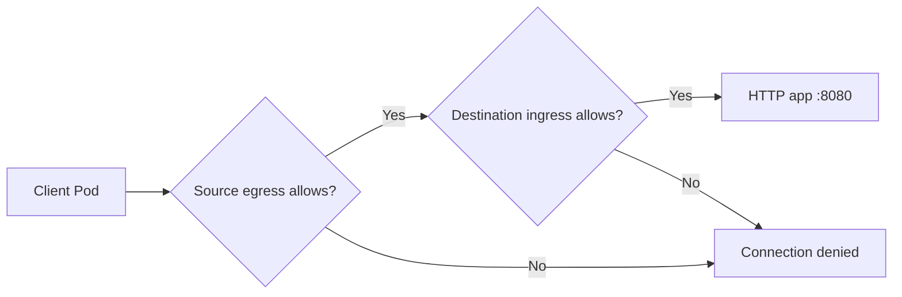
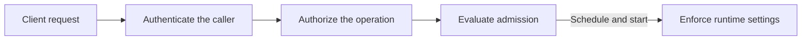

# Connect the security concepts

For each drill, identify the asset, the caller, the operation and the boundary that should control it. Then demonstrate an allowed operation, a prohibited operation and a healthy application. Explaining the difference makes the skill transferable to a new cluster, tool or exam task.

Use this page alongside the [study path](STUDY-PATH.md). Attempt the task first; use [worked references](../solutions/README.md) to compare the reasoning afterward.

## Network isolation is a decision at both ends

A Pod-to-Pod connection needs permission from the source's egress policy and the destination's ingress policy when those directions are isolated. Either end can block it. In the diagram, the destination is the practice HTTP workload, not the Kubernetes API server.

A failed connection alone does not identify which boundary stopped it. In [CS01](../labs/cluster-setup.md#cs01-network-isolation), the intruder's egress denial could hide an overly broad ingress rule. The independent probe first demonstrates working temporary egress, then checks destination ingress. Cleanup also has a traffic check.

In [CS06](../labs/cluster-setup.md#cs06-three-tier-traffic-and-policy-composition), egress stays open so the traffic matrix isolates ingress decisions. Test a correct label in the wrong namespace and a wrong label in the correct namespace. Then compare selectors in one peer entry with separate entries, and observe what an additional allow policy changes.

**Explain before moving on:** which policy denied the request, how you excluded a DNS or application failure, and which request would expose an overly broad answer.

## Identity, permission, admission and runtime are separate controls

When a client creates a Pod, the API server authenticates the caller, checks authorization and evaluates admission. Scheduling and the node runtime then determine whether the accepted workload can actually start with its requested controls.

| Question | Control | Practice |
|---|---|---|
| Who supplied this credential? | Authentication | [CH01](../labs/cluster-hardening.md#ch01-rbac-and-csrs): use the issued credential, not just administrator impersonation |
| May this identity perform this verb on this resource? | Authorization | [CH02](../labs/cluster-hardening.md#ch02-serviceaccounts): intended Pod reads work; Secret reads and Pod mutations fail |
| May this requested Pod configuration enter the cluster? | Admission | [MW01](../labs/workload-security.md#mw01-pod-security-admission) and [SC06](../labs/supply-chain.md#sc06-admission-policies): valid requests and specific policy rejections |
| What can the running process actually do? | Runtime enforcement | [MW02](../labs/workload-security.md#mw02-workload-hardening), [SH03](../labs/system-hardening.md#sh03-apparmor) and [SH04](../labs/system-hardening.md#sh04-seccomp): working applications and denied operations |

A Pod's later API requests use its own credentials and permissions. Disabling automatic token mounting changes credential availability; it does not remove an RBAC grant. Conversely, permission to create a Pod can expose a mounted namespace Secret through the kubelet even without direct Secret-read permission. CH02's optional extension demonstrates that boundary with dummy data.

**Explain before moving on:** whether your observation proves authentication, authorization, admission or runtime behaviour. Identify the caller in each step, especially when an administrator uses impersonation.

## An artifact keeps its identity through the supply chain

Build, scan, sign, inventory and deploy the same immutable artifact. The sequence in [SC01-SC07](../labs/supply-chain.md) records `PRACTICE_IMAGE` so each result can be tied to the final published digest.

| Evidence | Question it answers |
|---|---|
| Image digest | Which exact artifact is referenced? |
| Vulnerability report | What did this scanner and database report about that artifact? |
| Signature verification | Did the expected key or identity sign this artifact? |
| SBOM | Which components were identified in this artifact? |
| Provenance | Which source and build process produced it, and who attests to that claim? |
| Admission decision | Does the submitted workload satisfy the configured policy? |
| Running image identity and HTTP response | Did the intended artifact start and keep the application functional? |

A registry prefix identifies an allowed source location. Publisher identity, vulnerability findings and build provenance require their own evidence. When replacing a base image or rebuilding application code, treat the resulting digest as a new artifact and repeat the dependent checks.

**Explain before moving on:** how you know two reports concern the same artifact, which identity your verification trusts, and what changed after a rebuild.

## Detection, attribution and recovery complete the boundary

A useful security control has an observable result and a recovery path. Practice [RT01](../labs/runtime-security.md#rt01-falco-and-syscall-investigation) to connect process activity to an event, [RT02](../labs/runtime-security.md#rt02-audit-policy-and-investigation) to interpret actor/resource/status evidence, and [RT04](../labs/runtime-security.md#rt04-incident-response) to contain controlled activity while preserving healthy witnesses.

Distinguish a request from its outcome. A denied Secret read establishes that the request was rejected. When impersonation is used, separate the authenticated actor from the impersonated identity. Keep a healthy negative control when evaluating a detector: a quiet log is meaningful only when the event source and rule are working.

For host and control-plane work, rehearse [CH06 recovery](../labs/cluster-hardening.md#ch06-recover-an-unavailable-api-server) before changing admission or encryption configuration. Recovery access must work while the API is unavailable. Restore the baseline and verify it before the next drill.

## Turn an attempt into understanding

After each attempt, add a short explanation to your [progress log](PROGRESS.md):

1. **Boundary:** which principal or process was restricted, and from what operation?
2. **Evidence:** which allowed and denied requests demonstrated it?
3. **Counterexample:** which plausible wrong configuration would your checks catch?
4. **Recovery:** how did you restore the starting state and prove it worked?
5. **Transfer:** what changes if the namespace, port, identity, CNI or runtime changes?

Repeat the exercise independently with one deliberate variation. Once the reasoning is reliable, use the [timed sessions](SESSIONS.md) to practise retrieval, prioritization and execution under time pressure.
