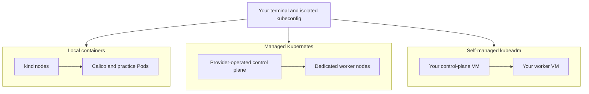

# Choose and create a practice environment

Start with **kind plus Calico** for the first session. Choose **kubeadm on disposable VMs** for host and control-plane practice. Use the [drill matrix](COMPATIBILITY.md) to match an environment to the skills you want to learn.

| Route | Setup | Best starting point |
|---|---|---|
| Local kind | [Automated local lifecycle](#kind-with-calico) | Networking, identity and workload fundamentals |
| EKS | [Terraform/OpenTofu profile](../infrastructure/eks/README.md) | Kubernetes identities and workloads on AWS |
| AKS | [Terraform/OpenTofu profile](../infrastructure/aks/README.md) | Cilium-backed workloads on Azure |
| GKE | [Terraform/OpenTofu profile](../infrastructure/gke/README.md) | Dataplane V2 workloads on GCP |
| kubeadm on GCP VMs | [Terraform/OpenTofu profile](../infrastructure/kubeadm-gcp/README.md) | Host, runtime, control-plane and recovery exercises |



All profiles expose the Kubernetes API for workload practice. Managed services operate their control plane for you. The VM profile gives you the host files, kernel controls and recovery access used by the node exercises. Check each drill's prerequisites before starting.

Commands use Bash from the repository root. Run each block separately and stop when a command fails. Prerequisites common to all profiles are `kubectl`, Python 3.11+, a trusted lab identity, and registry/network access for the named images. Match kubectl to the server minor version. Install tools through their official instructions; never use a production kubeconfig for these exercises.

For cloud automation, follow the [shared infrastructure workflow](../infrastructure/README.md): choose a dedicated profile, inspect its plan, apply it, connect, practise, then destroy its resources. The manual alternatives below expose the same setup concepts step by step.

## kind with Calico

**Prerequisites:** Docker with a working local Linux container engine, kind **v0.33.0**, kubectl **v1.37** and Python 3.11+. Budget approximately 4 CPUs, 8 GiB RAM and 15 GiB free disk for this two-node profile. Docker Desktop on macOS/Windows runs the nodes inside its Linux VM. Use dedicated VMs for the host/kernel exercises.

Create a new named practice environment from the repository root:

```bash
python3 scripts/environment.py create --name cks-practice
```

Setup creates the pinned cluster, installs checksum-verified Calico, waits for nodes and DNS, runs preflight and prepares the shared witness Pods. It keeps credentials and ownership information under `work/environments/cks-practice/`, and refuses to adopt an existing environment with the same name. It leaves the exercise controls for you to configure.

Run the exports printed by setup. For the default name they are:

```bash
export KUBECONFIG="$PWD/work/environments/cks-practice/kubeconfig"
export LAB_CONTEXT=kind-cks-practice
```

Continue with the [first session](LAB-SAFETY.md#first-session). In a later terminal, restore these exact exports before practice. Check the environment or remove it when finished:

```bash
python3 scripts/environment.py status --name cks-practice
python3 scripts/environment.py delete --name cks-practice
```

The lifecycle uses ownership checks before deletion. If setup stops, follow its recovery message and inspect the named environment; preserve its state directory until cleanup is complete. Keep your exercise answers and progress log separately under `work/` so they remain available for your next attempt.

### Manual kind setup

Use this alternative when you want to practise creating the environment yourself. It also requires curl and `sha256sum`; use a Linux/WSL shell or the GNU checksum utility on macOS. Start with a new cluster name and an isolated kubeconfig:

Create a private directory and reserve a new kubeconfig file. If `work/kubeconfig` exists, inspect its purpose and use another filename for this new environment rather than overwriting it:

```bash
umask 077
mkdir -p work
export KUBECONFIG="$PWD/work/kubeconfig"
test ! -e "$KUBECONFIG"
```


The [kind release](https://github.com/kubernetes-sigs/kind/releases/tag/v0.33.0) supplies the pinned Kubernetes **v1.37.0** node image in [kind.yaml](../labs/environments/kind.yaml). [Calico v3.33](https://docs.tigera.io/calico/latest/getting-started/kubernetes/requirements) lists Kubernetes 1.37 among its tested versions. This profile uses Calico **v3.33.0**, following its [kind installation guide](https://docs.tigera.io/calico/latest/getting-started/kubernetes/kind). The [completed checks](VALIDATION.md) record the observed practice results for this profile.

Check that `cks-practice` is absent from the cluster list. Check that the Pod subnet `192.168.0.0/16` does not overlap your host/VPN network. If it does, choose another private range and update both the copied kind config and Calico pool before creation.

```bash
docker info
kind version
kind get clusters
kind create cluster --name cks-practice \
  --config labs/environments/kind.yaml --kubeconfig "$KUBECONFIG"
export LAB_CONTEXT=kind-cks-practice
kubectl --context "$LAB_CONTEXT" get nodes
```

Nodes are initially NotReady because the default CNI is disabled. Download the pinned Calico manifest into the private working directory, verify its checksum, review it, and install it only into this new cluster. This setup-only subshell stops on any failed download, integrity or readiness check:

```bash
(
set -euo pipefail
curl --fail --location \
  https://raw.githubusercontent.com/projectcalico/calico/v3.33.0/manifests/calico.yaml \
  --output work/calico-v3.33.0.yaml
printf '%s  %s\n' 2de8f47595fb9c41b3f47d7b767a1f8e72ecf84057af834738ff12689a234da5 \
  work/calico-v3.33.0.yaml | sha256sum --check
less work/calico-v3.33.0.yaml
kubectl --context "$LAB_CONTEXT" create -f work/calico-v3.33.0.yaml
kubectl --context "$LAB_CONTEXT" -n kube-system rollout status daemonset/calico-node --timeout=300s
kubectl --context "$LAB_CONTEXT" -n kube-system rollout status deployment/calico-kube-controllers --timeout=300s
kubectl --context "$LAB_CONTEXT" wait --for=condition=Ready nodes --all --timeout=180s
kubectl --context "$LAB_CONTEXT" -n kube-system rollout status deployment/coredns --timeout=180s
python3 scripts/lab.py --context "$LAB_CONTEXT" preflight
)
```

Confirm the [lab identity and record its UID](LAB-SAFETY.md#select-the-cluster-deliberately), then continue with the [shared baseline and first session](LAB-SAFETY.md#first-session). A Ready CNI is not proof of policy enforcement; CS01's behavioural verifier supplies that check after the exercise is solved.

**Manual teardown:** after saving non-secret results, remove only this manually created cluster. Confirm it disappears from `kind get clusters`. Delete only its kubeconfig and downloaded manifest when no longer needed. For a cluster created through `scripts/environment.py`, use that script's `delete` command instead.

```bash
kind delete cluster --name cks-practice --kubeconfig "$KUBECONFIG"
kind get clusters
```

If creation or CNI setup fails, inspect `kubectl --context "$LAB_CONTEXT" get pods -A` and the failing Pod's events/logs. `kind export logs work/kind-logs --name cks-practice` captures local diagnostics. Keep these outputs private. Delete and recreate this owned cluster after correcting the cause; do not install a second CNI over the failed one.

## Cloud preparation

The [infrastructure profiles](../infrastructure/README.md) automate dedicated cloud resources. The commands below are manual alternatives. Reserve a new isolated kubeconfig before following a manual cloud guide, using the same private-directory steps as [manual kind setup](#manual-kind-setup).

Cloud commands below **create billable resources**. Use a dedicated training account/project or resource group, set a budget alert, check quotas, and choose an expiry time. Budget alerts do not stop spending. Keep a record of cluster, network, disks, public IPs and load balancers created by the session. Deleting a namespace does not delete the cluster or all provider resources.

Use a maintained provider CLI and authenticate before beginning. Select the account/subscription/project explicitly. Set `LAB_PUBLIC_CIDR` to your workstation/VPN's actual stable public IPv4 address with `/32`; do not copy an example address or use `0.0.0.0/0`. This restricts API access, so a changed VPN/egress address requires an intentional update.

Cloud version availability varies by region. Query it first and set `LAB_K8S_VERSION` to an offered exact version, preferably 1.37. Record any different minor version in your progress log and use its matching documentation. Do not bypass provider support restrictions to match the exam baseline. The cloud guides are documented profiles, not claims that every region offers the same version.

## EKS with managed Linux nodes

**Prerequisites:** AWS CLI v2, eksctl, a training AWS identity with permissions for EKS, EC2/VPC, IAM and CloudFormation, and quota for two Linux nodes. This profile uses Amazon VPC CNI. Its standalone-Pod restriction means **CS01, CS02, CS06, RT04 and CAP01 are unavailable with the supplied fixtures**. AWS documents that policy enforcement may be unreliable without Pod owner references. Use kind or kubeadm for those drills; do not mistake a successful policy API request for enforcement. [EKS NetworkPolicy limits](https://docs.aws.amazon.com/eks/latest/userguide/cni-network-policy.html)

Set an existing training profile and a region. Verify the returned account before continuing; `cks-practice` must not already appear in the successful cluster-list response:

```bash
export AWS_PROFILE=training
export AWS_REGION=eu-west-1
aws sts get-caller-identity
aws eks list-clusters --region "$AWS_REGION"
aws eks describe-cluster-versions --region "$AWS_REGION"
```

Set `LAB_K8S_VERSION` and `LAB_PUBLIC_CIDR` as described above. Create `work/eks.yaml` with the following content after replacing `REGION`, `VERSION` and `PUBLIC_CIDR`. Keep the file for deletion:

```yaml
apiVersion: eksctl.io/v1alpha5
kind: ClusterConfig
metadata:
  name: cks-practice
  region: REGION
  version: "VERSION"
vpc:
  clusterEndpoints:
    publicAccess: true
    privateAccess: true
  publicAccessCIDRs: ["PUBLIC_CIDR"]
managedNodeGroups:
  - name: practice
    instanceType: t3.medium
    desiredCapacity: 2
    minSize: 2
    maxSize: 2
    privateNetworking: true
```

This also provisions a VPC and private-node egress infrastructure, including billable NAT. Review eksctl's plan and account before accepting creation. [Creation and deletion](https://docs.aws.amazon.com/eks/latest/eksctl/creating-and-managing-clusters.html), [endpoint configuration](https://docs.aws.amazon.com/eks/latest/eksctl/vpc-cluster-access.html).

```bash
eksctl create cluster -f work/eks.yaml --write-kubeconfig=false
aws eks update-kubeconfig --name cks-practice --region "$AWS_REGION" \
  --kubeconfig "$KUBECONFIG" --alias cks-eks
export LAB_CONTEXT=cks-eks
kubectl --context "$LAB_CONTEXT" wait --for=condition=Ready nodes --all --timeout=300s
python3 scripts/lab.py --context "$LAB_CONTEXT" preflight
```

Confirm the [lab identity and record its UID](LAB-SAFETY.md#select-the-cluster-deliberately), then use the [baseline](LAB-SAFETY.md#shared-starting-state) and start with CH02 and MW02. Authentication uses the selected AWS credential chain; retain `AWS_PROFILE` in each practice shell. [Isolated kubeconfig](https://docs.aws.amazon.com/cli/latest/reference/eks/update-kubeconfig.html).

**Teardown:** finish drill cleanup and delete any exercise-created Ingress/LoadBalancer resources while their controllers still run. Recheck `aws sts get-caller-identity`, then delete using the saved configuration and wait for completion:

```bash
eksctl delete cluster -f work/eks.yaml --wait
aws eks list-clusters --region "$AWS_REGION"
```

Verify the related CloudFormation stacks finish deletion and inspect the recorded VPC/NAT, disks and load balancers for leftovers. Keep the kubeconfig/configuration until cleanup is confirmed. Deleting the cluster alone is not proof that billing has stopped.

## AKS Standard with Azure CNI powered by Cilium

**Prerequisites:** Azure CLI, a dedicated subscription/resource group, permission to create AKS and its managed identity/network resources, and node quota. This guide creates a fresh Standard cluster with Linux nodes. It does not modify a shared cluster or install a second policy engine. [Cilium setup](https://learn.microsoft.com/en-us/azure/aks/azure-cni-powered-by-cilium).

Set `LAB_SUBSCRIPTION` to the training subscription ID and `LAB_LOCATION` to your chosen region. Use a new dedicated group name. Verify the subscription and that the group-existence result is `false` before creation:

```bash
export LAB_RESOURCE_GROUP=cks-practice-rg
az account show --subscription "$LAB_SUBSCRIPTION" --query '{id:id,name:name,tenant:tenantId}'
az group exists --subscription "$LAB_SUBSCRIPTION" --name "$LAB_RESOURCE_GROUP"
az aks get-versions --subscription "$LAB_SUBSCRIPTION" --location "$LAB_LOCATION" --output table
```

Choose the offered `LAB_K8S_VERSION` and your `LAB_PUBLIC_CIDR`. Generate a new lab SSH key only if the path is unused. The group is dedicated so its eventual deletion removes only this session's resources:

```bash
ssh-keygen -t rsa -b 4096 -f work/aks-node-key -N ''
az group create --subscription "$LAB_SUBSCRIPTION" \
  --name "$LAB_RESOURCE_GROUP" --location "$LAB_LOCATION"
az aks create --subscription "$LAB_SUBSCRIPTION" \
  --resource-group "$LAB_RESOURCE_GROUP" --name cks-practice \
  --kubernetes-version "$LAB_K8S_VERSION" --node-count 2 --node-vm-size Standard_D4s_v5 \
  --network-plugin azure --network-plugin-mode overlay --network-dataplane cilium \
  --enable-managed-identity --ssh-key-value work/aks-node-key.pub \
  --api-server-authorized-ip-ranges "$LAB_PUBLIC_CIDR"
az aks get-credentials --subscription "$LAB_SUBSCRIPTION" \
  --resource-group "$LAB_RESOURCE_GROUP" --name cks-practice \
  --admin --file "$KUBECONFIG" --context cks-aks
export LAB_CONTEXT=cks-aks
kubectl --context "$LAB_CONTEXT" wait --for=condition=Ready nodes --all --timeout=300s
python3 scripts/lab.py --context "$LAB_CONTEXT" preflight
```

The isolated admin credential is only for this disposable lab. If policy prohibits local admin credentials, use the organization's Entra/kubelogin access path and have the required Kubernetes permissions provisioned; do not weaken that policy. Confirm the [lab identity and record its UID](LAB-SAFETY.md#select-the-cluster-deliberately), then establish the shared baseline. Inspect the actual DNS resolver before solving CS01. The node key uses the RSA form documented by [AKS SSH setup](https://learn.microsoft.com/en-us/azure/aks/manage-ssh-node-access). [API authorized ranges](https://learn.microsoft.com/en-us/azure/aks/api-server-authorized-ip-ranges), [AKS CLI](https://learn.microsoft.com/en-us/cli/azure/aks).

**Teardown:** finish drill/controller cleanup. List the group's resources and confirm every item belongs to this lab, then delete the dedicated group and wait. This deletes everything in that group:

```bash
az resource list --subscription "$LAB_SUBSCRIPTION" --resource-group "$LAB_RESOURCE_GROUP" --output table
az group delete --subscription "$LAB_SUBSCRIPTION" --name "$LAB_RESOURCE_GROUP" --yes
az group exists --subscription "$LAB_SUBSCRIPTION" --name "$LAB_RESOURCE_GROUP"
```

The last result must be `false`. Verify the associated node resource group is also gone and check recorded disks/public IPs for leftovers before removing local credentials.

## GKE Standard with Dataplane V2

**Prerequisites:** gcloud, the `gke-gcloud-auth-plugin`, a dedicated billing-enabled training project, enabled Compute/GKE APIs, cluster creation/IAM permissions and node quota. Use Standard for this profile. Autopilot adds admission and node-access restrictions and is outside this guide. [Dataplane V2](https://docs.cloud.google.com/kubernetes-engine/docs/how-to/dataplane-v2), [cluster access](https://docs.cloud.google.com/kubernetes-engine/docs/how-to/cluster-access-for-kubectl).

Set `LAB_PROJECT` and a single `LAB_ZONE` explicitly. Verify the active account and project. A zonal two-node cluster avoids accidentally requesting two nodes in every zone of a regional cluster:

```bash
gcloud auth list --filter=status:ACTIVE
gcloud projects describe "$LAB_PROJECT" --format='value(projectId,projectNumber)'
gcloud container clusters list --project "$LAB_PROJECT"
gcloud container get-server-config --project "$LAB_PROJECT" --zone "$LAB_ZONE"
```

Confirm `cks-practice` is absent. Choose an offered `LAB_K8S_VERSION` in the regular release channel and set `LAB_PUBLIC_CIDR`. Set `LAB_REGION` to the region containing your zone. Inspect the project networks, subnetworks and service accounts; the names below must be unused. These ranges must not overlap any connected lab/VPN network. [VPC-native prerequisites](https://docs.cloud.google.com/kubernetes-engine/docs/how-to/alias-ips).

```bash
export LAB_NETWORK=cks-practice-net
export LAB_SUBNET=cks-practice-subnet
export LAB_NODE_SA="cks-practice-nodes@${LAB_PROJECT}.iam.gserviceaccount.com"
gcloud compute networks list --project "$LAB_PROJECT"
gcloud compute networks subnets list --project "$LAB_PROJECT"
gcloud iam service-accounts list --project "$LAB_PROJECT"
gcloud compute networks create "$LAB_NETWORK" --project "$LAB_PROJECT" --subnet-mode custom
gcloud compute networks subnets create "$LAB_SUBNET" --project "$LAB_PROJECT" \
  --network "$LAB_NETWORK" --region "$LAB_REGION" --range 10.50.0.0/20 \
  --secondary-range cks-pods=10.60.0.0/16,cks-services=10.70.0.0/20
gcloud iam service-accounts create cks-practice-nodes --project "$LAB_PROJECT"
gcloud projects add-iam-policy-binding "$LAB_PROJECT" \
  --member "serviceAccount:$LAB_NODE_SA" --role roles/container.defaultNodeServiceAccount --condition=None
```

The dedicated node identity receives only the [minimum node role](https://docs.cloud.google.com/kubernetes-engine/security/configure-node-service-accounts); it does not need Editor. The cluster creator needs permission to use this account. Continue after its IAM grant is effective:

```bash
gcloud container clusters create cks-practice --project "$LAB_PROJECT" --zone "$LAB_ZONE" \
  --cluster-version "$LAB_K8S_VERSION" --release-channel regular \
  --num-nodes 2 --machine-type e2-standard-2 --disk-size 30 \
  --network "$LAB_NETWORK" --subnetwork "$LAB_SUBNET" \
  --enable-ip-alias --cluster-secondary-range-name cks-pods --services-secondary-range-name cks-services \
  --service-account "$LAB_NODE_SA" --enable-dataplane-v2 \
  --enable-master-authorized-networks --master-authorized-networks "$LAB_PUBLIC_CIDR"
gcloud container clusters get-credentials cks-practice --project "$LAB_PROJECT" --zone "$LAB_ZONE"
export LAB_CONTEXT="gke_${LAB_PROJECT}_${LAB_ZONE}_cks-practice"
kubectl --context "$LAB_CONTEXT" wait --for=condition=Ready nodes --all --timeout=300s
python3 scripts/lab.py --context "$LAB_CONTEXT" preflight
```

`get-credentials` writes the isolated `KUBECONFIG` selected above. Confirm the [lab identity and record its UID](LAB-SAFETY.md#select-the-cluster-deliberately), then establish the shared baseline. Record any automatic version changes. CNI handling of `ipBlock` and DNS can differ from Calico; use the actual resolver destinations in CS01, and CS02's explicit peer rules. [GKE NetworkPolicy differences](https://docs.cloud.google.com/kubernetes-engine/docs/how-to/network-policy).

**Teardown:** remove drill-created Ingress and LoadBalancer resources first, then delete the named cluster and wait for the command to finish:

```bash
gcloud container clusters delete cks-practice --project "$LAB_PROJECT" --zone "$LAB_ZONE"
gcloud container clusters list --project "$LAB_PROJECT"
```

Check recorded disks, forwarding rules, reserved addresses and firewall rules. After confirming no remaining resource uses the dedicated network/identity, remove their exact names:

```bash
gcloud compute networks subnets delete "$LAB_SUBNET" --project "$LAB_PROJECT" --region "$LAB_REGION"
gcloud compute networks delete "$LAB_NETWORK" --project "$LAB_PROJECT"
gcloud projects remove-iam-policy-binding "$LAB_PROJECT" \
  --member "serviceAccount:$LAB_NODE_SA" --role roles/container.defaultNodeServiceAccount --condition=None
gcloud iam service-accounts delete "$LAB_NODE_SA" --project "$LAB_PROJECT"
```

Verify those objects no longer appear in provider inventory. Do not delete the entire project unless it was created solely for this practice and its contents have been reviewed.

## kubeadm on cloud VMs

This is the full-access profile for CH03-CH06, host/kernel drills, live auditing, encryption and SC09. It is separate from a provider-managed Kubernetes control plane. Provision one `cks-control` and one `cks-worker` VM on AWS, Azure or GCP with **Ubuntu 24.04 LTS, at least 2 vCPUs/4 GiB RAM each and 30 GiB disk**. Use a dedicated private network, unique hostnames, stable private addresses, SSH/console access and coordinated snapshots. Create a third private VM only when doing CS02. Provider creation guides: [EC2](https://docs.aws.amazon.com/AWSEC2/latest/UserGuide/EC2_GetStarted.html), [Azure VMs](https://learn.microsoft.com/en-us/azure/virtual-machines/linux/quick-create-portal), [Compute Engine](https://docs.cloud.google.com/compute/docs/instances/create-start-instance).

Restrict SSH and API access to the lab administrator/network. Allow required control-plane/node ports only between lab machines, plus the selected CNI's internal traffic. Never expose etcd or kubelet endpoints to the internet. Record provider instance/disk/network IDs for deletion. [Kubernetes ports](https://kubernetes.io/docs/reference/networking/ports-and-protocols/), [Calico requirements](https://docs.tigera.io/calico/latest/getting-started/kubernetes/requirements).

On **both new VMs**, use the same package selections. The following Ubuntu 24.04 path uses Docker's signed repository for containerd **2.x** and Kubernetes' versioned repository for kubeadm/kubelet/kubectl. It installs the runtime, not Docker Engine. Select and record exact available package versions so the second VM and later rebuilds use identical packages. [Runtime configuration](https://kubernetes.io/docs/setup/production-environment/container-runtimes/), [kubeadm installation](https://kubernetes.io/docs/setup/production-environment/tools/kubeadm/install-kubeadm/), [Docker repository instructions](https://docs.docker.com/engine/install/ubuntu/).

Run only on the new Ubuntu lab VMs. These paths and package repositories must not already belong to another installation:

```bash
sudo apt-get update
sudo apt-get install -y ca-certificates curl gpg
sudo install -m 0755 -d /etc/apt/keyrings
curl --fail --location https://download.docker.com/linux/ubuntu/gpg \
  --output /tmp/cks-docker.asc
sudo install -m 0644 /tmp/cks-docker.asc /etc/apt/keyrings/cks-docker.asc
printf 'deb [arch=%s signed-by=/etc/apt/keyrings/cks-docker.asc] https://download.docker.com/linux/ubuntu noble stable\n' \
  "$(dpkg --print-architecture)" | sudo tee /etc/apt/sources.list.d/cks-containerd.list
curl --fail --location https://pkgs.k8s.io/core:/stable:/v1.37/deb/Release.key \
  --output /tmp/cks-kubernetes.key
sudo gpg --dearmor --output /etc/apt/keyrings/cks-kubernetes.gpg /tmp/cks-kubernetes.key
printf '%s\n' 'deb [signed-by=/etc/apt/keyrings/cks-kubernetes.gpg] https://pkgs.k8s.io/core:/stable:/v1.37/deb/ /' \
  | sudo tee /etc/apt/sources.list.d/cks-kubernetes.list
sudo apt-get update
apt-cache madison containerd.io kubeadm kubelet kubectl
```

Set `LAB_CONTAINERD_PACKAGE` to an available supported **2.x** package version and `LAB_K8S_PACKAGE` to an exact common **1.37.x** package version from that output, including the package revision suffix. Save the selections in your private session notes. Install and configure the fresh runtime:

```bash
sudo apt-get install -y "containerd.io=$LAB_CONTAINERD_PACKAGE" \
  "kubeadm=$LAB_K8S_PACKAGE" "kubelet=$LAB_K8S_PACKAGE" "kubectl=$LAB_K8S_PACKAGE"
sudo apt-mark hold containerd.io kubeadm kubelet kubectl
sudo mkdir -p /etc/containerd
containerd config default | sudo tee /etc/containerd/config.toml >/dev/null
sudo sed -i 's/SystemdCgroup = false/SystemdCgroup = true/' /etc/containerd/config.toml
sudo grep -n -E 'disabled_plugins|SystemdCgroup|io.containerd.cri.v1.runtime' /etc/containerd/config.toml
sudo systemctl enable --now containerd
sudo systemctl restart containerd
sudo modprobe overlay
sudo modprobe br_netfilter
printf '%s\n' overlay br_netfilter | sudo tee /etc/modules-load.d/cks.conf
printf '%s\n' 'net.ipv4.ip_forward = 1' 'net.bridge.bridge-nf-call-iptables = 1' \
  | sudo tee /etc/sysctl.d/90-cks.conf
sudo sysctl --system
sudo swapoff -a
```

Inspect the generated containerd configuration: CRI must be enabled and the runc handler's `SystemdCgroup` must be true. Disable the new VM's swap entry in `/etc/fstab` if present, preserving unrelated mount entries, and verify `swapon --show` remains empty after reboot. The kubelet package supplies its CNI dependency; confirm `/opt/cni/bin` exists and `crictl` is installed before continuing. CH05 instead needs a separate 1.36 starting snapshot and matching versioned package repository.

Before initialization, verify swap handling, IP forwarding, unique node identity, runtime health and the configured CRI socket. AppArmor must remain enabled for SH03. These checks belong on the node, not on the workstation:

```bash
hostname
ip -brief address
swapon --show
sysctl net.ipv4.ip_forward
containerd --version
sudo systemctl is-active containerd
sudo crictl --runtime-endpoint unix:///run/containerd/containerd.sock info
kubeadm version -o short
kubelet --version
```

**Control plane:** set `LAB_CONTROL_IP` to its private IP and choose a matching exact `LAB_K8S_VERSION`. Ensure the Pod range does not overlap the VM network. Initialize with a private reachable endpoint:

```bash
sudo kubeadm init --kubernetes-version "$LAB_K8S_VERSION" \
  --apiserver-advertise-address "$LAB_CONTROL_IP" \
  --control-plane-endpoint "$LAB_CONTROL_IP:6443" \
  --pod-network-cidr 192.168.0.0/16 \
  --cri-socket unix:///run/containerd/containerd.sock
```

Use the generated short-lived join command on the **worker**, adding the matching CRI socket if needed. Keep its token private. Securely copy the control plane's `admin.conf` into the workstation's new `work/kubeconfig`, using SSH/SCP over the private lab network. Do not print its contents, commit it, or expose the API publicly just to make it reachable. A VPN/bastion route must exist from the workstation. [kubeadm cluster creation](https://kubernetes.io/docs/setup/production-environment/tools/kubeadm/create-cluster-kubeadm/).

On the workstation, select the copied context. Download and verify the same pinned Calico manifest as the kind guide. For this cloud-VM profile, copy it to `work/calico-vm.yaml`, set the `calico-node` container environment variable `CALICO_IPV4POOL_IPIP` to `Never`, and add `CALICO_IPV4POOL_VXLAN` with value `Always`. Keep `192.168.0.0/16` as the pool range unless you changed the kubeadm Pod subnet. Make those edits **before** creating Calico, so the initial pool uses VXLAN. Allow UDP 4789 between the two private VM addresses; keep it closed to unrelated sources. [Calico overlay configuration](https://docs.tigera.io/calico/latest/networking/configuring/vxlan-ipip).

```bash
export LAB_CONTEXT=kubernetes-admin@kubernetes
kubectl config use-context "$LAB_CONTEXT"
kubectl --context "$LAB_CONTEXT" get nodes -o wide
kubectl --context "$LAB_CONTEXT" create -f work/calico-vm.yaml
kubectl --context "$LAB_CONTEXT" -n kube-system rollout status daemonset/calico-node --timeout=300s
kubectl --context "$LAB_CONTEXT" -n kube-system rollout status deployment/calico-kube-controllers --timeout=300s
kubectl --context "$LAB_CONTEXT" wait --for=condition=Ready nodes --all --timeout=180s
kubectl --context "$LAB_CONTEXT" -n kube-system rollout status deployment/coredns --timeout=180s
python3 scripts/lab.py --context "$LAB_CONTEXT" preflight
```

After Calico and CoreDNS are healthy, both nodes must be Ready. Confirm the [lab identity and record its UID](LAB-SAFETY.md#select-the-cluster-deliberately), establish the baseline, and take a coordinated recovery snapshot. Verify recovery access without Kubernetes before any host/control-plane drill. Additional components such as Falco, Istio and gVisor are installed only for their named drills using compatible upstream instructions.

**Teardown:** save non-secret evidence, terminate only the recorded VMs, wait for provider deletion, and remove their task-owned disks/snapshots, IPs and network resources in dependency order. For Azure, a dedicated lab resource group can provide the deletion boundary; inspect it first. For AWS/GCP, use the recorded instance IDs and project/region/zone. Verify provider inventory and billing resources rather than treating `kubeadm reset` or stopped VMs as deletion. Remove local kubeconfig and keys after cleanup is verified.

The [kubeadm GCP profile](../infrastructure/kubeadm-gcp/README.md) automates the VM infrastructure and provides the cluster bootstrap route. Use the manual VM procedure above to practise the individual setup steps or adapt them deliberately to another provider.
